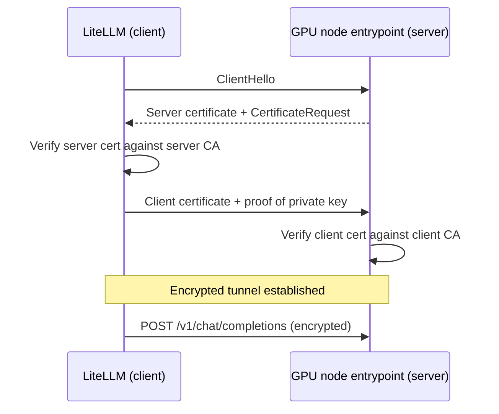
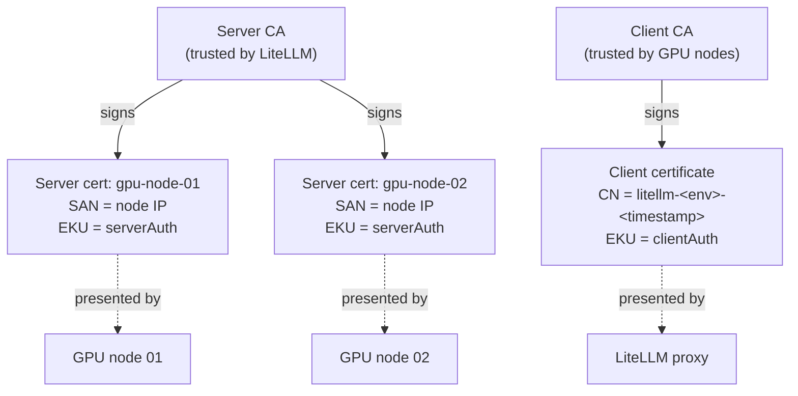
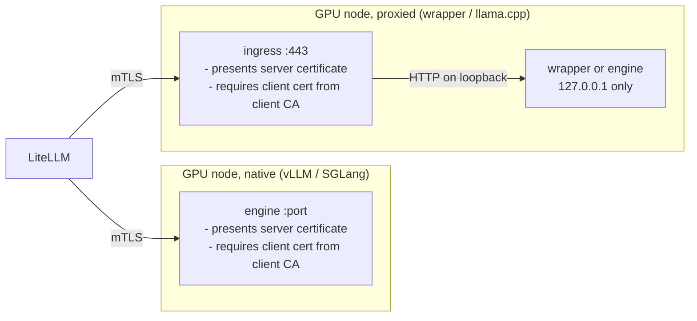
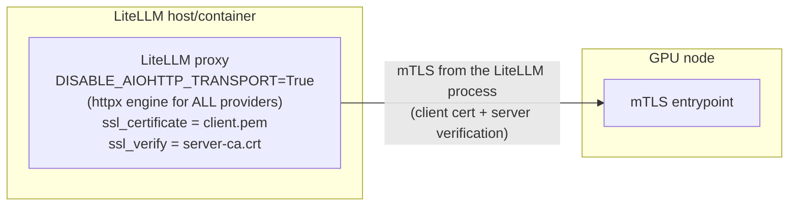
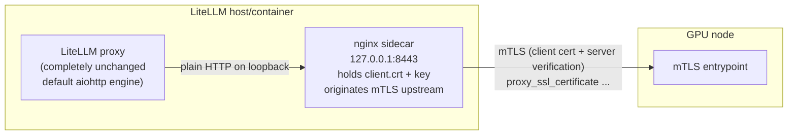
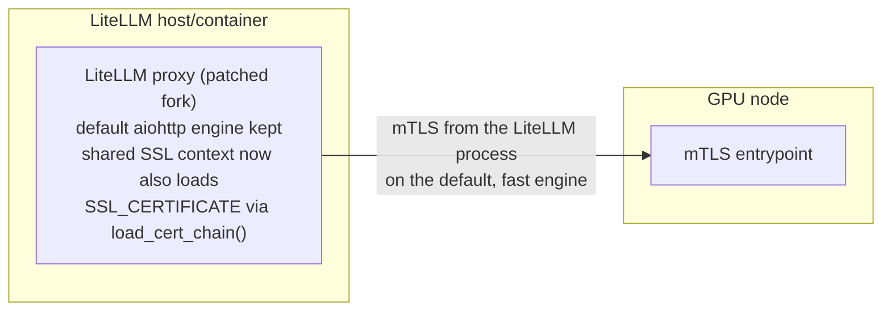
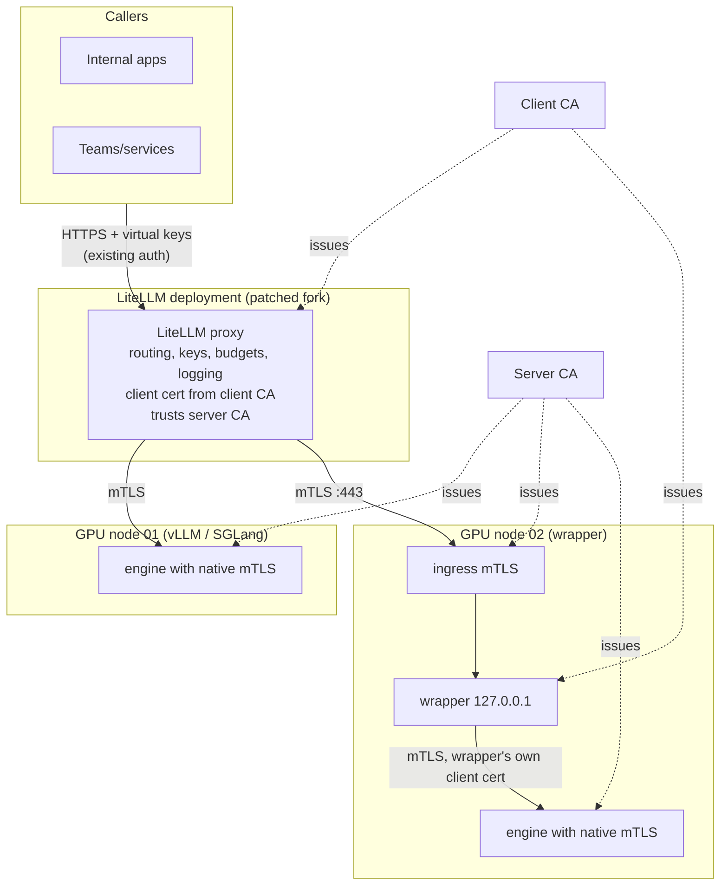
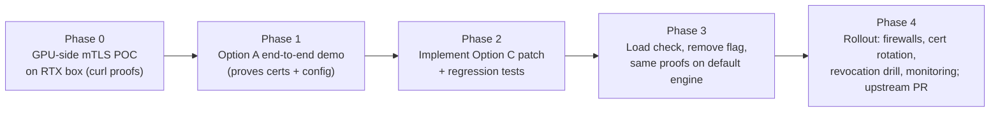

# mTLS between LiteLLM and GPU Inference Nodes: Design Options

Status: accepted; Option C implemented. Operational procedure: [mtls-fleet-sop.md](mtls-fleet-sop.md)
Date: 2026-11-02 (revised 2026-11-09)
Audience: engineering (written so a fresher can follow, detailed enough for review)
Scope: traffic from LiteLLM (fork, v1.92.0) to self-hosted GPU nodes running GPUStack v2.2.0, SGLang, or vLLM

## 1. Problem statement

Today LiteLLM calls GPU inference endpoints over plain HTTP. Requirements from the platform team:

1. Encrypt LiteLLM -> GPU traffic in transit
2. LiteLLM must prove it is talking to the correct GPU server (server authentication)
3. GPU servers must accept connections only from authorized LiteLLM instances (client authentication)
4. No measurable regression on LiteLLM's default request path performance
5. The solution must survive routine LiteLLM upgrades

Points 2 and 3 together are mutual TLS (mTLS).

## 2. Background in 60 seconds

TLS: the server presents a certificate; the client verifies it against a trusted CA; traffic is encrypted. The client stays anonymous.

mTLS: additionally, the server requests a certificate from the client and verifies it against a CA the server trusts. Both identities are checked before any application data flows.



Two internal CAs are involved: a server CA that signs one certificate per GPU node (its private key stays on the node), and a client CA that signs one certificate per LiteLLM deployment or wrapper (its private key stays on that host). Splitting them is what makes client revocation possible without touching server certs, since no engine supports CRLs or CN allowlists (SOP §0.1, §5.2).



## 3. Key technical finding that shapes the design

LiteLLM already exposes the two knobs needed for mTLS:

- `ssl_certificate` / `SSL_CERTIFICATE`: the client certificate LiteLLM presents
- `ssl_verify` / `SSL_VERIFY` / `SSL_CERT_FILE`: the CA file used to verify the server certificate. Some providers also accept it per model in `litellm_params`, but the `openai/` provider used for these backends only reads the global setting

However, LiteLLM builds outgoing calls through one of two internal HTTP engines:

| Engine | Role | Client certificate sent? |
|---|---|---|
| httpx transport | classic engine | yes |
| aiohttp transport | default engine (chosen for throughput) | no; silently dropped |

Verified in the fork (v1.92.0): `cert=` is passed to `httpx.AsyncClient`, but when a custom transport (aiohttp) is supplied, httpx ignores `cert=` entirely, and the aiohttp connector is never given the client certificate. Reproduced against httpx 0.28.1: `_init_transport()` returns the custom transport before `cert` is applied.

Also verified on upstream `main` (v1.109.0, checked 2026-11-02): the same gap exists. There is no `load_cert_chain` call anywhere in upstream `litellm/`, and the aiohttp transport creation takes no certificate parameter. Upgrading LiteLLM will not fix this.

Conclusion: any design that relies on LiteLLM's default engine silently fails; this is the central constraint the options below address.

## 4. Component common to all options: the GPU-side mTLS entrypoint

Every GPU node needs an entrypoint that presents its server certificate and requires a client certificate issued by the client CA. Where the engine can do this itself, it does; otherwise an ingress proxy does it and the engine binds to loopback.

| Backend | mTLS entrypoint | How |
|---|---|---|
| vLLM (incl. GPUStack-launched) | engine itself | `--ssl-certfile/--ssl-keyfile/--ssl-ca-certs` + `--ssl-cert-reqs=2`, passed through to uvicorn |
| SGLang | engine itself | same TLS flags plus a 5-line patch that turns client verification on (SOP §2) |
| Business-logic wrapper, llama.cpp | ingress proxy (Caddy/nginx) | proxy requires the client cert; wrapper/engine listens on loopback (SOP §3) |



This block is identical in Options A, B, and C. The options differ only in how the LiteLLM side originates the mTLS connection.

## 5. Option A: force the httpx engine (config only)

LiteLLM is configured to use its classic engine globally so that `ssl_certificate` actually takes effect.



Configuration delta only:

```yaml
# config.yaml
litellm_settings:
  ssl_certificate: /etc/litellm/client.pem   # single PEM: cert + key
  ssl_verify: /etc/litellm/server-ca.crt
model_list:
  - model_name: rtx-model
    litellm_params:
      model: openai/<served-model-name>
      api_base: https://10.0.0.11/v1          # must match server cert SAN
      api_key: os.environ/GPUSTACK_API_KEY
```

```bash
export DISABLE_AIOHTTP_TRANSPORT=True
```

Pros:
- Zero code change; demo-ready in minutes
- mTLS originates inside the LiteLLM process, end to end

Cons:
- The performance-oriented default engine is disabled for every provider call (OpenAI, Anthropic, etc.), not just GPU nodes; this carries production throughput risk
- Upgrade hazard: any deployment that forgets the flag silently reverts to broken mTLS
- The underlying aiohttp gap remains in the codebase forever

Effort: hours. Risk: performance regression at scale.

## 6. Option B: client-side nginx sidecar originates mTLS

LiteLLM is left untouched. A local nginx on the LiteLLM host accepts plaintext loopback traffic from LiteLLM and originates the mTLS connection to the GPU node.



Sidecar sketch:

```nginx
server {
    listen 127.0.0.1:8443;
    location / {
        proxy_pass https://10.0.0.11:443;
        proxy_ssl_certificate     /etc/nginx/mtls/client.crt;
        proxy_ssl_certificate_key /etc/nginx/mtls/client.key;
        proxy_ssl_trusted_certificate /etc/nginx/mtls/server-ca.crt;
        proxy_ssl_verify on;
        proxy_ssl_name 10.0.0.11;
        proxy_buffering off;
        proxy_read_timeout 600s;
    }
}
```

Pros:
- No LiteLLM code or flag changes; default engine and its performance preserved
- Works with any LiteLLM version, including future upgrades

Cons:
- New infrastructure to build, deploy, monitor, and certificate-manage (one listener per GPU node or a routing layer)
- The mTLS boundary stops at the sidecar; LiteLLM -> sidecar is plaintext loopback, so the protection is per-hop rather than process-to-node
- Connection pooling, retries, and streaming semantics now depend on one more proxy in the path
- Debugging spans two proxies and two teams' configs

Effort: days. Risk: operational complexity.

## 7. Option C (implemented): patch LiteLLM so the default engine supports client certificates

Make the shared SSL context carry the client certificate, so the aiohttp connector itself presents it. LiteLLM builds every outgoing SSL configuration in one place, `get_ssl_configuration()` -> `_create_ssl_context()` in `litellm/llms/custom_httpx/http_handler.py`; teaching that path to load the client cert chain fixes every transport at once.



What the change does (`http_handler.py`):

```python
client_cert = get_ssl_client_certificate()   # SSL_CERTIFICATE env, then litellm.ssl_certificate;
                                             # raises SSLCertificateError if set but missing
cache_key = (cafile, ssl_security_level, ssl_ecdh_curve, client_cert)
# _create_ssl_context(..., client_cert) calls context.load_cert_chain(certfile=client_cert)
# and raises SSLCertificateError on any load failure
```

Two properties are deliberate:

- **Fail closed.** If `ssl_certificate` is configured but cannot be loaded, requests fail with `SSLCertificateError` rather than downgrading to one-way TLS.
- **Trust is not widened.** The `ssl_verify` file remains the only trust anchor set. Deployments that also call public providers from the same process build a combined bundle explicitly (SOP §4.5.3) instead of LiteLLM merging public roots in behind the operator's back.

Pros:
- mTLS originates inside the LiteLLM process on the default, fastest engine; no performance tradeoff
- One change fixes async, sync, and streaming paths simultaneously
- No new infrastructure; configuration identical to Option A from an operator's view
- Regression tests lock the behavior against a real strict-mTLS server; future LiteLLM upgrades (upstream v1.109.0 still lacks this) cannot silently re-break it
- Cleanly upstreamable to BerriAI/litellm, removing fork drift over time

Cons:
- Requires a code change and tests in the fork
- Fork maintains a patch until upstream merges an equivalent
- `ssl_certificate` is process-wide, so a mixed GPU/public-cloud deployment must manage its trust bundle explicitly (above)

Effort: about a day including tests. Risk: low; surface area is the SSL context builder plus its cache key.

## 8. Comparison

| Criterion | A: force httpx | B: sidecar | C: patch (implemented) |
|---|---|---|---|
| Code change | none | none | ~60 lines + tests |
| Performance | degraded for all providers | unchanged | unchanged |
| Extra infrastructure | none | nginx sidecar per route | none |
| mTLS end-to-end from LiteLLM process | yes | no (stops at sidecar) | yes |
| Works on default engine | no (engine disabled) | n/a | yes |
| Upgrade resilience | fragile (flag) | good | good (test-guarded) |
| Config surface for operators | 2 settings + flag | none in LiteLLM | 2 settings |
| Time to first demo | hours | days | about a day |

## 9. Target architecture



Defense in depth: keep GPUStack/engine API keys in addition to mTLS. mTLS authenticates the calling machine; the API key authenticates the calling application.

## 10. Rollout plan



Phase exit criteria:

1. Phase 0: the SOP §0.4 matrix passes on the POC node (valid client cert accepted; no cert, forged cert and server-cert-as-client refused)
2. Phase 1: `/chat/completions` via LiteLLM returns 200 through the mTLS route
3. Phase 2/3: the same with `DISABLE_AIOHTTP_TRANSPORT` unset
4. Phase 4: alerts on certificate expiry; SOP §5.2 revocation drill run once on a canary node, showing the old client cert refused and the replacement accepted

## 11. Verification evidence to capture

- SOP §0.4 matrix output for every node (no `FAIL` lines)
- LiteLLM proxy `/chat/completions` 200 through each mTLS route
- If the same LiteLLM also serves public providers: one successful call per provider with the combined trust bundle
- SOP §5.2 revocation drill output
- Regression tests in CI: local strict-mTLS server asserts the client certificate is demanded and presented

## 12. Certificate generation reference

Certificate profiles and exact commands live in the SOP only, to avoid two drifting copies: CAs in §0.1, node server certs in §0.2, client certs in §0.3.

## 13. Version evidence

| Item | Version | Source |
|---|---|---|
| Fork (this repo) | v1.92.0 | `pyproject.toml` |
| Upstream latest checked | v1.109.0 (`main`) | fetched 2026-11-02; aiohttp client-cert gap still present |
| httpx behavior | 0.28.1 | `cert=` ignored when a custom transport is supplied |
| vLLM | 0.23.1rc1 | `ssl_ca_certs` / `ssl_cert_reqs` passed through to uvicorn |
| SGLang | nightly-dev-20260917-408d2334 | TLS flags exposed, client verification hard-coded off (patched) |
| GPU stack | GPUStack v2.2.0 | no client-cert flag of its own; launched vLLM accepts the flags via backend parameters |
