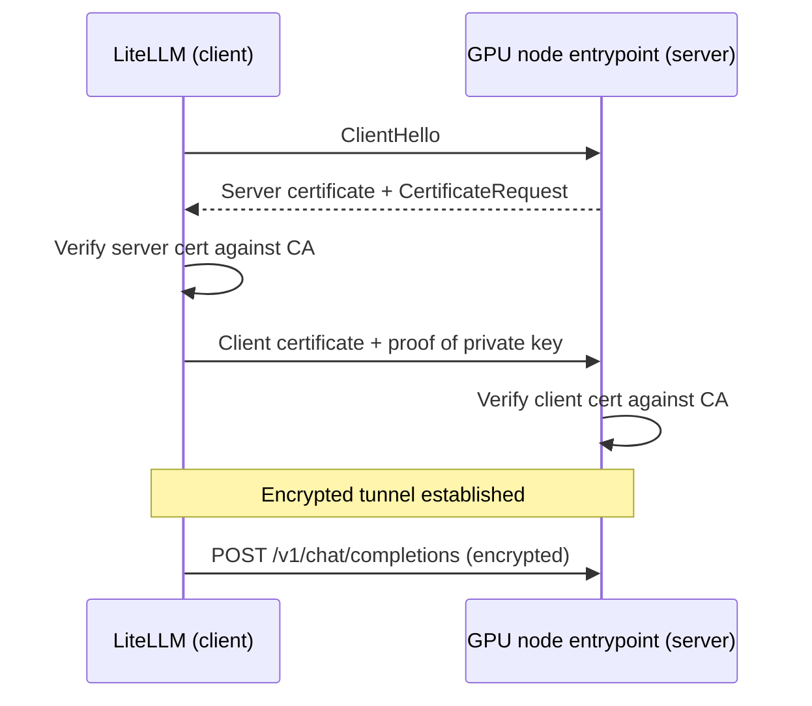
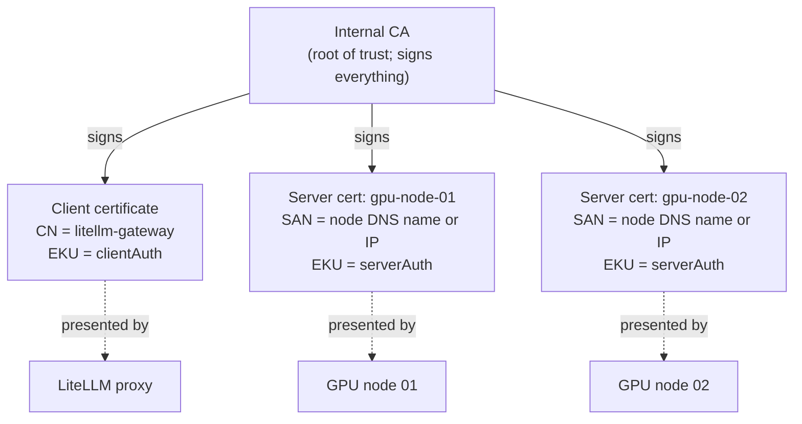
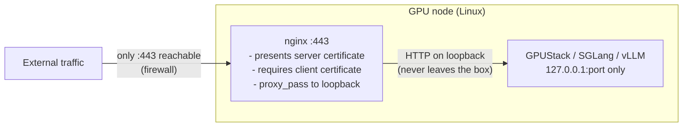
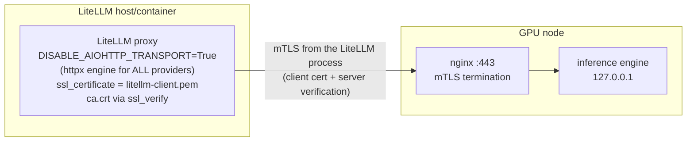
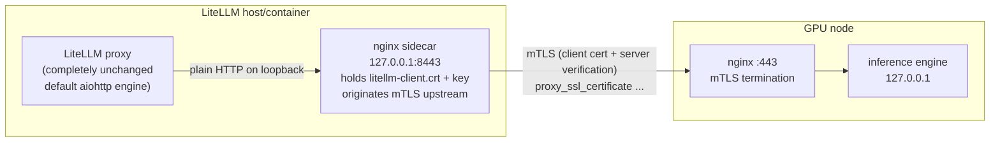
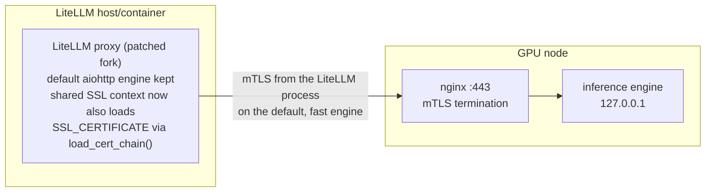
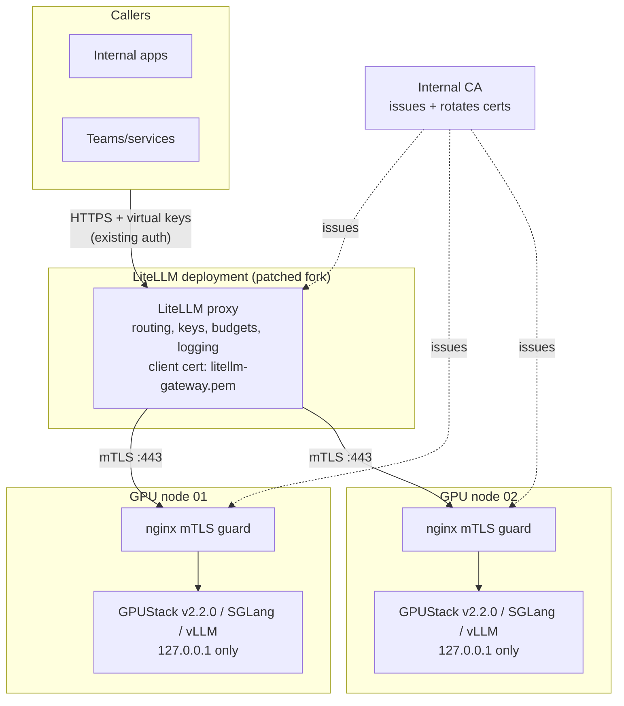
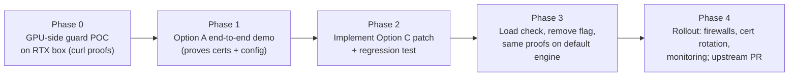

# mTLS between LiteLLM and GPU Inference Nodes: Design Options

Status: proposal
Date: 2026-11-02
Audience: engineering (written so a fresher can follow, detailed enough for review)
Scope: traffic from LiteLLM (fork, v1.92.0) to self-hosted GPU nodes running GPUStack v2.2.0, SGLang, or vLLM

## 1. Problem statement

Today LiteLLM calls GPU inference endpoints over plain HTTP. Requirements from the platform team:

1. Encrypt LiteLLM -> GPU traffic in transit
2. LiteLLM must prove it is talking to the correct GPU server (server authentication)
3. GPU servers must accept connections only from authorized LiteLLM instances (client authentication)
4. No measurable regression on LiteLLM's default request path performance
5. The solution must survive routine LiteLLM upgrades

Points 2 and 3 together are mutual TLS (mTLS).

## 2. Background in 60 seconds

TLS: the server presents a certificate; the client verifies it against a trusted CA; traffic is encrypted. The client stays anonymous.

mTLS: additionally, the server requests a certificate from the client and verifies it against a CA the server trusts. Both identities are checked before any application data flows.



Three artifacts are involved: one internal CA (the root of trust), one server certificate per GPU node (its private key stays on the node), and one client certificate per LiteLLM deployment (its private key stays on the LiteLLM host).



## 3. Key technical finding that shapes the design

LiteLLM already exposes the two knobs needed for mTLS:

- `ssl_certificate` / `SSL_CERTIFICATE`: the client certificate LiteLLM presents
- `ssl_verify` / `SSL_VERIFY` / `SSL_CERT_FILE`: the CA used to verify the server certificate; also settable per model in `litellm_params`

However, LiteLLM builds outgoing calls through one of two internal HTTP engines:

| Engine | Role | Client certificate sent? |
|---|---|---|
| httpx transport | classic engine | yes |
| aiohttp transport | default engine (chosen for throughput) | no; silently dropped |

Verified in the fork (v1.92.0): `cert=` is passed to `httpx.AsyncClient`, but when a custom transport (aiohttp) is supplied, httpx ignores `cert=` entirely, and the aiohttp connector is never given the client certificate. Reproduced against httpx 0.28.1: `_init_transport()` returns the custom transport before `cert` is applied.

Also verified on upstream `main` (v1.109.0, checked 2026-11-02): the same gap exists. There is no `load_cert_chain` call anywhere in upstream `litellm/`, and the aiohttp transport creation takes no certificate parameter. Upgrading LiteLLM will not fix this.

Conclusion: any design that relies on LiteLLM's default engine silently fails; this is the central constraint the options below address.

## 4. Component common to all options: the GPU-side guard

GPUStack, SGLang, and vLLM can serve HTTPS for their own certificates but none of them can require and verify client certificates. A reverse proxy therefore terminates mTLS on every GPU node, and the inference engine binds to loopback only.



This block is identical in Options A, B, and C. The options differ only in how the LiteLLM side originates the mTLS connection.

## 5. Option A: force the httpx engine (config only)

LiteLLM is configured to use its classic engine globally so that `ssl_certificate` actually takes effect.



Configuration delta only:

```yaml
# config.yaml
litellm_settings:
  ssl_certificate: /etc/litellm/litellm-client.pem   # single PEM: cert + key
model_list:
  - model_name: rtx-model
    litellm_params:
      model: openai/<served-model-name>
      api_base: https://gpu-node-01.internal/v1      # must match server cert SAN
      api_key: os.environ/GPUSTACK_API_KEY
      ssl_verify: /etc/litellm/ca.crt
```

```bash
export DISABLE_AIOHTTP_TRANSPORT=True
```

Pros:
- Zero code change; demo-ready in minutes
- mTLS originates inside the LiteLLM process, end to end

Cons:
- The performance-oriented default engine is disabled for every provider call (OpenAI, Anthropic, etc.), not just GPU nodes; this carries production throughput risk
- Upgrade hazard: any deployment that forgets the flag silently reverts to broken mTLS
- The underlying aiohttp gap remains in the codebase forever

Effort: hours. Risk: performance regression at scale.

## 6. Option B: client-side nginx sidecar originates mTLS

LiteLLM is left untouched. A local nginx on the LiteLLM host accepts plaintext loopback traffic from LiteLLM and originates the mTLS connection to the GPU node.



Sidecar sketch:

```nginx
server {
    listen 127.0.0.1:8443;
    location / {
        proxy_pass https://gpu-node-01.internal:443;
        proxy_ssl_certificate     /etc/nginx/mtls/litellm-client.crt;
        proxy_ssl_certificate_key /etc/nginx/mtls/litellm-client.key;
        proxy_ssl_trusted_certificate /etc/nginx/mtls/ca.crt;
        proxy_ssl_verify on;
        proxy_ssl_server_name on;
        proxy_ssl_name gpu-node-01.internal;
        proxy_buffering off;
        proxy_read_timeout 600s;
    }
}
```

Pros:
- No LiteLLM code or flag changes; default engine and its performance preserved
- Works with any LiteLLM version, including future upgrades

Cons:
- New infrastructure to build, deploy, monitor, and certificate-manage (one listener per GPU node or a routing layer)
- The mTLS boundary stops at the sidecar; LiteLLM -> sidecar is plaintext loopback, so the protection is per-hop rather than process-to-node
- Connection pooling, retries, and streaming semantics now depend on one more proxy in the path
- Debugging spans two proxies and two teams' configs

Effort: days. Risk: operational complexity.

## 7. Option C (recommended): patch LiteLLM so the default engine supports client certificates

Make the shared SSL context carry the client certificate, so the aiohttp connector itself presents it. LiteLLM builds every outgoing SSL configuration in one place, `get_ssl_configuration()` -> `_create_ssl_context()` in `litellm/llms/custom_httpx/http_handler.py`; teaching that single function to load the client cert chain fixes every path at once.



Change sketch (small, single-function):

```python
# in _create_ssl_context() (http_handler.py)
client_cert = os.getenv("SSL_CERTIFICATE", litellm.ssl_certificate)
if client_cert:
    context.load_cert_chain(certfile=client_cert)   # PEM holding cert + key
# cert path added to _ssl_context_cache key so certs are not mixed across configs
```

Pros:
- mTLS originates inside the LiteLLM process on the default, fastest engine; no performance tradeoff
- One change fixes async, sync, streaming, and websocket paths simultaneously
- No new infrastructure; configuration identical to Option A from an operator's view
- Regression test locks the behavior; future LiteLLM upgrades (upstream v1.109.0 still lacks this) cannot silently re-break it
- Cleanly upstreamable to BerriAI/litellm, removing fork drift over time

Cons:
- Requires a code change and test in the fork (small, one function)
- Fork maintains a patch until upstream merges an equivalent

Effort: about a day including tests. Risk: low; surface area is one function plus cache key.

## 8. Comparison

| Criterion | A: force httpx | B: sidecar | C: patch (recommended) |
|---|---|---|---|
| Code change | none | none | ~30 lines + test |
| Performance | degraded for all providers | unchanged | unchanged |
| Extra infrastructure | none | nginx sidecar per route | none |
| mTLS end-to-end from LiteLLM process | yes | no (stops at sidecar) | yes |
| Works on default engine | no (engine disabled) | n/a | yes |
| Upgrade resilience | fragile (flag) | good | good (test-guarded) |
| Config surface for operators | 2 settings + flag | none in LiteLLM | 2 settings |
| Time to first demo | hours | days | about a day |

## 9. Recommended target architecture



Defense in depth: keep GPUStack/engine API keys in addition to mTLS. mTLS authenticates the calling machine; the API key authenticates the calling application.

## 10. Rollout plan



Phase exit criteria:

1. Phase 0: `curl` without client cert is rejected; with client cert succeeds (nginx `$ssl_client_verify=SUCCESS`)
2. Phase 1: `/chat/completions` via LiteLLM returns 200 and the GPU nginx log shows the LiteLLM client DN
3. Phase 2/3: identical success logs with the disable-flag removed, `DISABLE_AIOHTTP_TRANSPORT` unset
4. Phase 4: alerts on certificate expiry, rotation runbook tested once

## 11. Verification evidence to capture

- `curl -v --cacert ca.crt https://<node>/v1/models` (no client cert): TLS/HTTP rejection
- `curl -v --cacert ca.crt --cert litellm-client.pem https://<node>/v1/models`: HTTP 200
- GPU nginx access log: `$ssl_client_verify=SUCCESS` and `$ssl_client_s_dn` = `CN=litellm-gateway`
- LiteLLM proxy `/chat/completions` 200 through the mTLS route
- Regression test in CI: local mTLS test server asserts the client certificate is demanded and presented

## 12. Certificate generation reference

```bash
# CA (add basicConstraints; OpenSSL 3.x omits it otherwise)
openssl req -x509 -new -nodes -key ca.key -sha256 -days 3650 \
  -subj "/CN=internal-gpu-ca" -addext "basicConstraints=critical,CA:TRUE" -out ca.crt

# Server cert per node: SAN must match the exact host/IP used in api_base
printf "subjectAltName=DNS:gpu-node-01.internal,IP:10.0.0.11\nextendedKeyUsage=serverAuth\nkeyUsage=digitalSignature,keyEncipherment\n" > server.ext
openssl x509 -req -in gpu-server.csr -CA ca.crt -CAkey ca.key -CAcreateserial \
  -days 365 -sha256 -extfile server.ext -out gpu-server.crt

# Client cert for LiteLLM
printf "extendedKeyUsage=clientAuth\nkeyUsage=digitalSignature,keyEncipherment\n" > client.ext
openssl x509 -req -in litellm-client.csr -CA ca.crt -CAkey ca.key -CAcreateserial \
  -days 365 -sha256 -extfile client.ext -out litellm-client.crt

# LiteLLM consumes a single PEM for SSL_CERTIFICATE
cat litellm-client.crt litellm-client.key > litellm-client.pem
```

## 13. Version evidence

| Item | Version | Source |
|---|---|---|
| Fork (this repo) | v1.92.0 | `pyproject.toml` |
| Upstream latest checked | v1.109.0 (`main`) | fetched 2026-11-02; aiohttp client-cert gap still present |
| httpx behavior | 0.28.1 | `cert=` ignored when a custom transport is supplied |
| GPU stack | GPUStack v2.2.0 | no client-cert enforcement flag; HTTPS only via `--ssl-keyfile/--ssl-certfile` |
